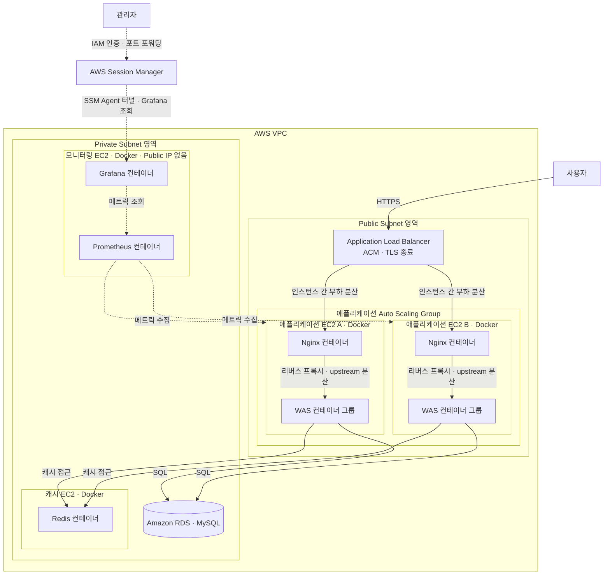
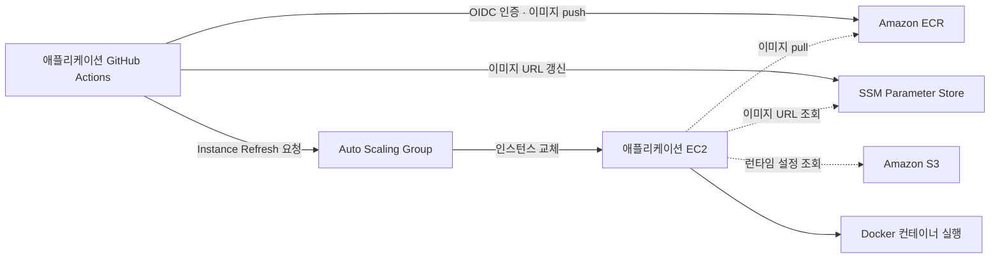
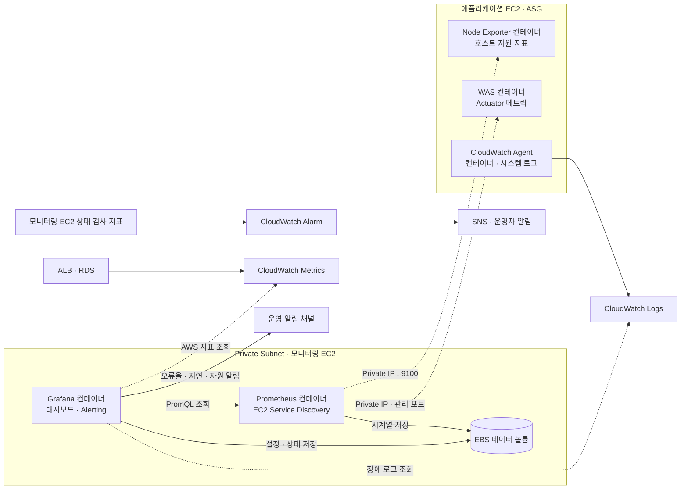

# Jeonlog Infrastructure

**전시 플랫폼 전록의 AWS 서비스 아키텍처와 배포·모니터링 환경**

전록(Jeonlog)은 8명이 함께 개발한 전시 플랫폼 애플리케이션입니다. 개발환경 구축과 배포를 담당하고, 약 6개월간 서비스를 운영하며 모니터링 환경과 네트워크 구성을 개선했습니다.

| 항목 | 내용 |
| --- | --- |
| 프로젝트 기간 | 2025.11 ~ 2026.07 |
| 팀 규모 · 담당 | 8명 · 개발환경 구축, 배포 및 인프라 운영 |
| 서비스 운영 | 약 6개월, 종료 시 회원 130명 |
| 주요 기술 | AWS ALB · EC2 · Auto Scaling · RDS · ECR, Nginx, Docker, Prometheus, Grafana, Terraform |

## 서비스 아키텍처

**ALB → 여러 EC2의 Nginx → WAS**로 이어지는 요청 처리 구조입니다. 애플리케이션 EC2와 별도로 모니터링 EC2를 두고, 모니터링 서버와 RDS는 Private Subnet에 배치합니다. EC2에서 운영하는 Nginx, WAS, Prometheus, Grafana, Redis는 모두 Docker 컨테이너로 실행합니다.

아래는 서비스의 요청 처리 구조에 **모니터링 개선 설계**를 반영한 구성도입니다. 모니터링의 프라이빗 배치, Redis 분리, Session Manager 접근은 설계안이며, 현재 코드의 배포 상태와는 구분합니다. 운영 중 ALB를 제거한 이력은 아래 운영 경험에 정리했습니다.



실선은 서비스 요청·데이터 접근, 점선은 모니터링·관리 흐름입니다. Session Manager 연결은 EC2의 SSM Agent가 시작하는 아웃바운드 세션을 사용합니다. EC2 두 대와 WAS 그룹은 분산 구조를 표현하며, 실제 인스턴스·컨테이너 수나 AZ 배치를 의미하지 않습니다. ALB와 RDS는 AWS 관리형 서비스입니다.

### 요청 처리와 부하 분산

1. **ALB — 서비스 진입점:** 사용자의 HTTPS 요청을 받아 TLS를 종료하고, 상태 검사를 통과한 EC2의 Nginx로 트래픽을 분산합니다. HTTP 요청은 HTTPS로 리다이렉트합니다.
2. **Nginx — EC2 내부의 요청 라우팅:** 컨테이너로 실행되며 WAS에 요청을 전달하는 리버스 프록시 역할을 합니다. 여러 WAS를 upstream으로 구성하면 해당 대상 사이에서도 부하를 분산합니다.
3. **WAS — 애플리케이션 처리:** Docker 컨테이너에서 비즈니스 로직을 실행하고, RDS와 Redis에 접근합니다. 응답은 Nginx와 ALB를 거쳐 사용자에게 반환됩니다.
4. **Auto Scaling — EC2 단위 확장:** 애플리케이션 인스턴스 수를 조절합니다. 저장소에는 평균 CPU 사용률 60%를 목표로 하는 확장 정책과 순차 인스턴스 교체 설정이 포함되어 있습니다.

ALB는 **EC2 사이의 분산**, Nginx는 **WAS로의 전달과 upstream 대상 사이의 분산**을 담당합니다. Nginx의 upstream이 WAS 한 개라면 해당 구간은 프록시 역할만 수행합니다.

### 네트워크와 데이터 계층

| 영역 | 구성 | 역할과 접근 경계 |
| --- | --- | --- |
| Public Subnet | ALB, 애플리케이션 EC2 | 외부 요청은 ALB를 통해 받고, EC2의 서비스 인바운드는 ALB 보안그룹을 기준으로 제한 |
| Private Subnet | 모니터링 EC2 | Public IP 없이 내부 주소로 지표 수집, Grafana는 Session Manager 포트 포워딩으로 조회 |
| Private Subnet | RDS MySQL | 애플리케이션 데이터를 저장하고, 허용된 보안그룹에서만 DB 접근 |
| Private Subnet | 별도 캐시 EC2의 Redis 컨테이너 | WAS에서 내부 주소로 접근, 모니터링 서버와 자원·장애 범위 분리 |

모니터링 EC2는 지표 수집과 대시보드 조회를 담당하고, 관리자 접속은 Session Manager가 담당하도록 역할을 나눕니다. Redis는 별도 EC2로 분리해 모니터링 서버의 재시작이나 메모리 부족이 캐시 장애로 이어지는 것을 줄입니다. 프라이빗 서버의 AWS API 호출과 이미지 다운로드에는 Public Subnet의 NAT Gateway를 통한 아웃바운드 경로를 사용하며, 상세 경로는 [모니터링 설계](docs/monitoring-architecture.md)에 정리했습니다.

## Docker 기반 실행과 배포

EC2 위의 서비스는 컨테이너로 실행하고, 애플리케이션 이미지와 런타임 설정을 분리해 관리합니다. ECR은 이미지 저장소, SSM Parameter Store는 배포할 이미지 URL 전달, S3는 런타임 설정 제공에 사용합니다.



배포 파이프라인은 새 이미지를 ECR에 등록하고 SSM의 이미지 URL을 갱신한 뒤, ASG Instance Refresh를 요청합니다. 새 EC2는 이미지와 설정을 읽어 애플리케이션 컨테이너를 실행합니다. SSM 값 변경과 인스턴스 교체 요청은 별도 단계입니다.

GitHub Actions는 OIDC로 AWS 배포 역할을 사용합니다. 이 저장소는 해당 권한과 인프라, 부팅 스크립트를 관리하며, 이미지 빌드와 실제 배포 workflow는 애플리케이션 저장소에서 관리합니다.

## 모니터링과 로그 — 개선 설계

**수집은 Prometheus, 조회와 애플리케이션 알림은 Grafana, AWS 지표와 로그는 CloudWatch**로 역할을 나눕니다. 기존 Docker 기반 운영 방식에 맞춰 Prometheus와 Grafana는 별도 모니터링 EC2에서 함께 실행합니다.



점선은 조회·수집 요청, 실선은 저장·전송 경로입니다. 관리자 접근과 NAT를 통한 외부 통신은 별도 경로이며 [상세 설계](docs/monitoring-architecture.md)에서 설명합니다.

| 대상 | 수집·조회 경로 | 확인할 내용 |
| --- | --- | --- |
| EC2 호스트 | Node Exporter → Prometheus → Grafana | CPU·메모리·디스크·네트워크 |
| WAS | Spring Actuator → Prometheus → Grafana | 요청량·오류율·응답 지연·JVM 상태 |
| ALB·RDS | CloudWatch Metrics → Grafana | 정상 대상 수·ALB 오류·DB 연결 수·저장 공간 |
| 실행 로그 | CloudWatch Agent → CloudWatch Logs → Grafana | 컨테이너·시스템 오류 원인 |
| ALB 접근 기록 | ALB → S3 | 요청 단위 접근 로그 |
| 모니터링 EC2 장애 | EC2 상태 검사 → CloudWatch Alarm → SNS | 모니터링 서버와 독립된 장애 알림 |

Prometheus는 ASG 태그로 EC2를 자동 탐색하고 내부 주소의 메트릭 엔드포인트를 수집합니다. Node Exporter와 Actuator 관리 포트는 모니터링 보안그룹에만 허용하고, Nginx·ALB 경로에서는 Actuator 접근을 차단하도록 설계합니다. 여러 WAS를 운영할 경우 각 컨테이너의 수집 대상도 개별 등록해 인스턴스별 지표가 섞이지 않게 합니다.

Grafana는 호스트의 `127.0.0.1:3000`에만 바인딩하고 Session Manager 포트 포워딩으로 접속합니다. Prometheus는 Docker 내부 네트워크에서 Grafana에 제공하며 외부에 포트를 공개하지 않습니다. [AWS 포트 포워딩 문서](https://docs.aws.amazon.com/systems-manager/latest/userguide/session-manager-working-with-sessions-start.html)

Grafana의 CloudWatch 데이터소스는 EC2 IAM 역할로 필요한 지표와 로그를 읽도록 구성합니다. [Grafana CloudWatch 문서](https://grafana.com/docs/grafana/latest/datasources/aws-cloudwatch/configure/)

Prometheus·Grafana 데이터는 EBS에 영속화하고 스냅샷으로 백업하도록 계획합니다. 모니터링 EC2 한 대가 중단되면 수집·조회·Grafana 알림도 중단되므로, EC2 상태 검사 실패 알림은 CloudWatch와 SNS에 별도로 둡니다. 이 구조는 복구 가능한 단일 서버 설계이며 모니터링 고가용성 구성은 아닙니다.


기존 운영 환경의 인프라 지표 화면입니다. 위 개선 설계의 적용 결과를 의미하지 않습니다. 운영 중에는 별도로 DAU·MAU 등 서비스 이용 지표를 확인하는 Grafana 대시보드도 구성했습니다.

## 운영 경험과 설계 판단

- **팀의 개발·배포 환경 지원:** 8명 팀에서 애플리케이션을 실행할 AWS 인프라와 Docker 기반 배포 환경을 구축하고 운영했습니다.
- **서비스 상태의 가시성 확보:** 시스템 메트릭과 로그를 수집하고, 서비스 이용 지표를 조회할 대시보드를 구성했습니다.
- **네트워크 배치 개선:** DB와 Grafana의 리전 간 통신 비용 문제에 대응해 Grafana를 DB와 같은 리전·네트워크 대역으로 재배치하고 비공개 접근 환경을 구성했습니다.
- **운영 규모에 따른 구성 조정:** 운영 중 비용을 검토해 ALB를 제거했습니다. 위 구성도는 ALB가 있는 구조를 설명하며, 제거 이후의 최종 요청 경로와는 구분합니다.

회원 수는 서비스 종료 시 130명이며, 비용 절감률이나 무중단 배포 성과는 별도로 측정하지 않았습니다. 구체적인 경험은 [프로젝트·역할 소개](docs/portfolio.md)와 [운영 변경 기록](docs/operations-history.md)에 정리했습니다.

## 저장소 안내

Terraform은 기존 서비스 인프라와 배포 권한을 코드로 관리하는 데 사용했습니다. 모니터링 개선 설계는 문서에 먼저 정리했습니다.

```text
terraform/
├── live/ecr/    # 이미지 저장소와 GitHub OIDC 배포 권한
├── live/prod/   # 서비스 인프라, DB, 모니터링, 부팅 스크립트
└── modules/    # 네트워크, ALB, Auto Scaling 구성

docs/          # 설계·운영 경험·검증 자료
scripts/       # 로컬·CI 공통 검증 스크립트
```

**문서와 코드의 범위:** 저장소에는 공개 모니터링 EC2에서 Prometheus·Grafana·Redis를 함께 실행하는 기존 코드가 보존되어 있습니다. 프라이빗 배치, Redis 분리, Session Manager, NAT, 알림·백업은 개선 설계이며 Terraform에 반영되지 않았습니다. 앱 부팅 스크립트에는 Nginx·복수 WAS 구성이 없고, 코드상 앱 ASG는 단일 서브넷을 사용합니다.

- [모니터링 개선 설계와 적용 항목](docs/monitoring-architecture.md)
- [코드 기준 설계와 개선 과제](docs/architecture.md)
- [환경 준비와 운영 절차](docs/operations.md)
- [검증 기록](docs/verification.md)

로컬 검증은 Bash와 Terraform이 설치된 환경에서 실행합니다.

```bash
bash scripts/validate.sh
```

Terraform 형식·구성 및 Bash 구문을 검사하며, AWS 리소스를 생성하지 않습니다.
