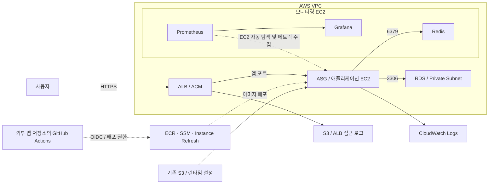

# Jeonlog Infrastructure

**Terraform으로 구성한 AWS 애플리케이션 인프라와 배포·모니터링 기반**

Jeonlog 애플리케이션의 네트워크, 실행 환경, 데이터베이스, 배포 권한과 관측 환경을 코드로 관리하는 프로젝트입니다. `network`, `alb`, `asg` 모듈을 조합하고, ECR/OIDC 스택과 운영 스택의 수명주기를 분리했습니다.

전록은 **2025.11 ~ 2026.07 진행한 8명 팀의 전시 플랫폼 앱 프로젝트**입니다. 개발환경 구축과 배포를 담당했으며, 서비스는 약 6개월 운영했고 종료 시 회원 수는 130명이었습니다. 운영 중 Grafana 이용 지표 대시보드 구성, 네트워크 배치 조정, ALB 제거를 수행했습니다.

> **코드와 최종 운영 상태의 차이:** 이 저장소에는 ALB와 공개 모니터링 EC2를 포함한 구성이 남아 있습니다. 운영 중 변경한 ALB 제거·비공개 접근 구성은 아래 코드 구성도와 다르며, [운영 변경 기록](docs/operations-history.md)에 별도로 정리했습니다.

검토 순서: **[프로젝트 요약](docs/portfolio.md) → [설계와 한계](docs/architecture.md) → [운영 절차](docs/operations.md) → [검증 기록](docs/verification.md)**

## 핵심 구현

| 영역 | 구현 내용 | 코드 |
| --- | --- | --- |
| 인프라 코드화 | VPC·서브넷·보안그룹, ALB, ASG를 모듈로 분리 | [modules](terraform/modules) |
| 트래픽과 접근 제어 | ACM HTTPS 종료, HTTP 리다이렉트, ALB → 앱 → RDS 보안그룹 참조 | [ALB](terraform/modules/alb/main.tf), [network](terraform/modules/network/main.tf) |
| 배포와 확장 | Launch Template, Rolling Instance Refresh, 평균 CPU 60% Target Tracking | [ASG](terraform/modules/asg/main.tf) |
| 배포 인증 | GitHub OIDC 역할, ECR push, SSM 이미지 파라미터 갱신 및 ASG refresh 권한 | [ECR/OIDC](terraform/live/ecr/main.tf) |
| 데이터 운영 | 기존 RDS 스냅샷으로 DB 생성, 비공개 접근, 백업 보존 7일 | [prod](terraform/live/prod/main.tf) |
| 관측 | EC2 Service Discovery 기반 Prometheus 수집, Grafana, CloudWatch 로그 | [모니터링](terraform/live/prod/scripts/grafana_setup.sh), [부팅 스크립트](terraform/live/prod/scripts/user_data.sh) |
| 구성 검증 | Terraform 형식·구성 검사와 Bash 구문 검사 자동화 | [검증 스크립트](scripts/validate.sh), [CI](.github/workflows/validate.yml) |

## 저장소 코드 기준 아키텍처



저장소 코드의 ASG는 **첫 번째 퍼블릭 서브넷 한 곳**에 배치됩니다. 여러 AZ에 서브넷을 만드는 것과 애플리케이션의 AZ 장애 대응은 구분합니다. 코드상 모니터링 EC2에는 Redis도 함께 실행됩니다.

## 배포 연계

1. 외부 애플리케이션 CI가 OIDC로 AWS 역할을 받아 ECR에 이미지를 push합니다.
2. `/jeonlog/prod/ecr-image-url` SSM 파라미터에 배포할 이미지 URL을 기록합니다.
3. CI가 ASG Instance Refresh를 명시적으로 요청합니다. **SSM 값 변경만으로 refresh가 자동 시작되지는 않습니다.**
4. 새 인스턴스가 S3의 런타임 설정과 SSM의 이미지 URL을 읽어 컨테이너를 실행합니다.
5. ALB의 상태 검사와 Prometheus·CloudWatch로 애플리케이션 상태를 확인합니다.

이 저장소에는 위 흐름의 **AWS 권한·인프라·부팅 스크립트**가 있습니다. 애플리케이션 이미지 빌드 및 실제 배포 workflow는 포함되어 있지 않습니다. 이 저장소의 CI는 인프라 코드 검증용입니다.

## 모니터링 자료


기존 저장소에 포함된 CPU·메모리·디스크·네트워크 메트릭 화면입니다. 메트릭 표시 사례를 보여주며, 부하 테스트·자동 확장·장애 복구 성공을 입증하는 자료는 아닙니다. 대시보드 JSON과 부하 테스트 결과는 현재 포함되어 있지 않습니다.

## 로컬 검증

Bash와 Terraform이 필요합니다. CI는 Terraform `1.15.8`을 사용하고, AWS provider는 각 스택의 lock 파일을 따릅니다.

```bash
bash scripts/validate.sh
```

provider를 내려받을 네트워크 연결이 필요합니다. AWS 자격 증명 없이 형식·구성·구문을 검사하며, 인프라를 생성하지 않습니다. 실제 배포 가능 여부는 환경별 `plan`과 운영 검증이 필요합니다.

## 환경 준비

샘플 변수 파일은 입력 형식 안내용이며 그대로 배포할 수 없습니다.

```bash
cp terraform/live/ecr/terraform.tfvars.example terraform/live/ecr/terraform.tfvars
cp terraform/live/prod/terraform.tfvars.example terraform/live/prod/terraform.tfvars
```

운영값을 채우기 전에 [선행 자원 및 AMI 요구사항](docs/operations.md)을 확인합니다. 기존 S3, ACM 인증서, RDS 스냅샷, 준비된 AMI 및 EC2 키페어가 필요합니다. ECR의 OIDC 신뢰 대상도 실제 앱 저장소와 일치해야 합니다.

## 현재 범위와 개선 과제

- Terraform 원격 state·locking 구성은 포함되지 않습니다.
- 준비된 AMI의 생성 과정과 앱 배포 workflow는 외부 의존성입니다.
- 무중단 배포, 자동 rollback, AZ 장애 복구, 비용 절감률은 검증된 성과로 제시하지 않습니다.
- Grafana·Prometheus 접근 CIDR의 기본값은 전체 공개입니다. 실제 사용 시 예시처럼 관리자 CIDR로 제한해야 합니다.
- Secret은 S3 및 Terraform 입력을 사용합니다. 전용 비밀 관리 시스템으로의 전환과 state 접근 통제가 개선 과제입니다.

구체적인 제약과 개선 우선순위는 [설계 문서](docs/architecture.md)에 정리했습니다.
