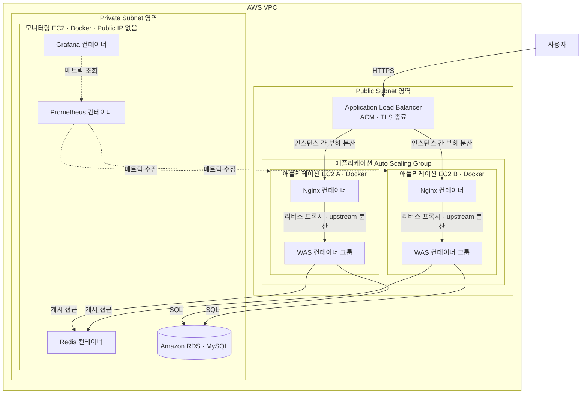
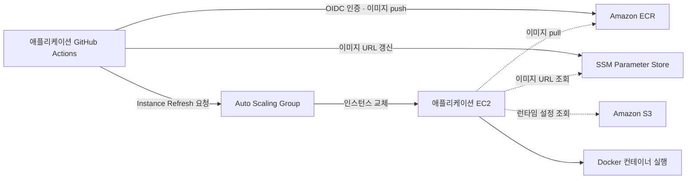
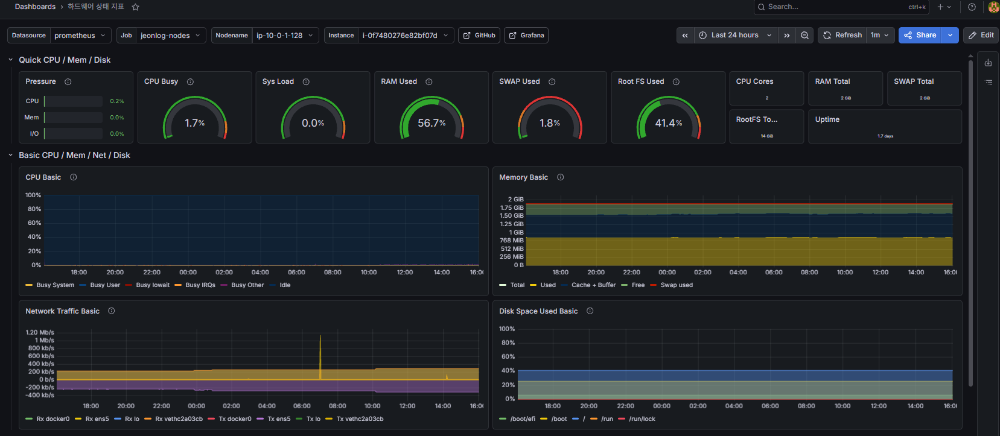

# Jeonlog Infrastructure

**전시 플랫폼 전록의 AWS 서비스 아키텍처와 배포·모니터링 환경**

전록(Jeonlog)은 8명이 함께 개발한 전시 플랫폼 애플리케이션입니다. 개발환경 구축과 배포를 담당하고, 약 6개월간 서비스를 운영하며 모니터링 환경과 네트워크 구성을 개선했습니다.

| 항목 | 내용 |
| --- | --- |
| 프로젝트 기간 | 2025.11 ~ 2026.07 |
| 팀 규모 · 담당 | 8명 · 개발환경 구축, 배포 및 인프라 운영 |
| 서비스 운영 | 약 6개월, 종료 시 회원 130명 |
| 주요 기술 | AWS ALB · EC2 · Auto Scaling · RDS · ECR, Nginx, Docker, Prometheus, Grafana, Terraform |

## 서비스 아키텍처

**ALB → 여러 EC2의 Nginx → WAS**로 이어지는 요청 처리 구조입니다. 애플리케이션 EC2와 별도로 모니터링 EC2를 두고, 모니터링 서버와 RDS는 Private Subnet에 배치합니다. EC2에서 운영하는 Nginx, WAS, Prometheus, Grafana, Redis는 모두 Docker 컨테이너로 실행합니다.

아래는 ALB를 사용하는 서비스 구조에 모니터링 EC2의 프라이빗 배치를 반영한 구성도입니다. 운영 중 ALB를 제거한 이력은 아래 운영 경험에 별도로 정리했습니다.



실선은 서비스 요청·데이터 접근, 점선은 모니터링 흐름입니다. EC2 두 대와 WAS 그룹은 분산 구조를 표현하며, 실제 인스턴스·컨테이너 수나 AZ 배치를 의미하지 않습니다. ALB와 RDS는 AWS 관리형 서비스입니다.

### 요청 처리와 부하 분산

1. **ALB — 서비스 진입점:** 사용자의 HTTPS 요청을 받아 TLS를 종료하고, 상태 검사를 통과한 EC2의 Nginx로 트래픽을 분산합니다. HTTP 요청은 HTTPS로 리다이렉트합니다.
2. **Nginx — EC2 내부의 요청 라우팅:** 컨테이너로 실행되며 WAS에 요청을 전달하는 리버스 프록시 역할을 합니다. 여러 WAS를 upstream으로 구성하면 해당 대상 사이에서도 부하를 분산합니다.
3. **WAS — 애플리케이션 처리:** Docker 컨테이너에서 비즈니스 로직을 실행하고, RDS와 Redis에 접근합니다. 응답은 Nginx와 ALB를 거쳐 사용자에게 반환됩니다.
4. **Auto Scaling — EC2 단위 확장:** 애플리케이션 인스턴스 수를 조절합니다. 저장소에는 평균 CPU 사용률 60%를 목표로 하는 확장 정책과 순차 인스턴스 교체 설정이 포함되어 있습니다.

ALB는 **EC2 사이의 분산**, Nginx는 **WAS로의 전달과 upstream 대상 사이의 분산**을 담당합니다. Nginx의 upstream이 WAS 한 개라면 해당 구간은 프록시 역할만 수행합니다.

### 네트워크와 데이터 계층

| 영역 | 구성 | 역할과 접근 경계 |
| --- | --- | --- |
| Public Subnet | ALB, 애플리케이션 EC2 | 외부 요청은 ALB를 통해 받고, EC2의 서비스 인바운드는 ALB 보안그룹을 기준으로 제한 |
| Private Subnet | 모니터링 EC2 | Public IP 없이 내부 주소로 지표 수집·조회, 관리 접속은 별도의 비공개 접근 경로로 분리 |
| Private Subnet | RDS MySQL | 애플리케이션 데이터를 저장하고, 허용된 보안그룹에서만 DB 접근 |
| 모니터링 EC2 내부 | Redis 컨테이너 | WAS에서 사용하는 캐시 제공, 애플리케이션에서 내부 주소로 접근 |

모니터링 EC2는 애플리케이션 서버와 분리해 지표 수집과 대시보드 조회를 담당합니다. 기존에 Bastion을 겸하던 공개 배치에서 프라이빗 배치로 변경한 구조를 반영했습니다. Redis는 같은 EC2에서 실행하므로, 이 서버의 장애는 모니터링과 캐시에 함께 영향을 줄 수 있습니다.

## Docker 기반 실행과 배포

EC2 위의 서비스는 컨테이너로 실행하고, 애플리케이션 이미지와 런타임 설정을 분리해 관리합니다. ECR은 이미지 저장소, SSM Parameter Store는 배포할 이미지 URL 전달, S3는 런타임 설정 제공에 사용합니다.



배포 파이프라인은 새 이미지를 ECR에 등록하고 SSM의 이미지 URL을 갱신한 뒤, ASG Instance Refresh를 요청합니다. 새 EC2는 이미지와 설정을 읽어 애플리케이션 컨테이너를 실행합니다. SSM 값 변경과 인스턴스 교체 요청은 별도 단계입니다.

GitHub Actions는 OIDC로 AWS 배포 역할을 사용합니다. 이 저장소는 해당 권한과 인프라, 부팅 스크립트를 관리하며, 이미지 빌드와 실제 배포 workflow는 애플리케이션 저장소에서 관리합니다.

## 모니터링과 로그

| 도구 | 수집·조회 대상 | 운영 목적 |
| --- | --- | --- |
| Prometheus | Node Exporter 및 WAS의 Spring Actuator 메트릭 | 서버 자원과 애플리케이션 상태 확인 |
| Grafana | Prometheus 메트릭 시각화 | CPU·메모리·디스크·네트워크 상태를 대시보드에서 조회 |
| CloudWatch Logs | 애플리케이션 컨테이너 로그, 시스템 로그 | 인스턴스별 실행 상태와 오류 원인 추적 |
| S3 | ALB 접근 로그 | 외부 요청 기록 확인 |

Prometheus는 EC2 Service Discovery로 ASG의 인스턴스를 탐색합니다. 인스턴스 교체·확장에 따라 수집 대상을 찾도록 구성해, 서버 IP를 수동으로 관리하는 부담을 줄였습니다.



운영 중 사용한 인프라 지표 대시보드입니다. 별도로 DAU·MAU 등 서비스 이용 지표를 확인하는 Grafana 대시보드도 구성했습니다.

## 운영 경험과 설계 판단

- **팀의 개발·배포 환경 지원:** 8명 팀에서 애플리케이션을 실행할 AWS 인프라와 Docker 기반 배포 환경을 구축하고 운영했습니다.
- **서비스 상태의 가시성 확보:** 시스템 메트릭과 로그를 수집하고, 서비스 이용 지표를 조회할 대시보드를 구성했습니다.
- **네트워크 배치 개선:** DB와 Grafana의 리전 간 통신 비용 문제에 대응해 Grafana를 DB와 같은 리전·네트워크 대역으로 재배치하고 비공개 접근 환경을 구성했습니다.
- **운영 규모에 따른 구성 조정:** 운영 중 비용을 검토해 ALB를 제거했습니다. 위 구성도는 ALB가 있는 구조를 설명하며, 제거 이후의 최종 요청 경로와는 구분합니다.

회원 수는 서비스 종료 시 130명이며, 비용 절감률이나 무중단 배포 성과는 별도로 측정하지 않았습니다. 구체적인 경험은 [프로젝트·역할 소개](docs/portfolio.md)와 [운영 변경 기록](docs/operations-history.md)에 정리했습니다.

## 저장소 안내

Terraform은 위 아키텍처의 인프라 구성과 배포 권한을 코드로 관리하기 위한 도구로 사용했습니다.

```text
terraform/
├── live/ecr/    # 이미지 저장소와 GitHub OIDC 배포 권한
├── live/prod/   # 서비스 인프라, DB, 모니터링, 부팅 스크립트
└── modules/    # 네트워크, ALB, Auto Scaling 구성

docs/          # 설계·운영 경험·검증 자료
scripts/       # 로컬·CI 공통 검증 스크립트
```

**문서와 코드의 범위:** 위 구성도는 서비스의 요청 처리 구조와 모니터링 EC2의 프라이빗 배치를 반영합니다. 보존된 Terraform에는 모니터링 EC2의 Public IP 및 공개 서브넷 설정이 남아 있고, 앱 부팅 스크립트에는 Nginx·복수 WAS 구성이 포함되어 있지 않습니다. 실제 반영 시에는 Nginx 설정·ALB 대상 포트와 함께 프라이빗 서버의 관리 접속 및 이미지 다운로드 경로를 구성해야 합니다. 코드상 앱 ASG는 단일 서브넷을 사용합니다.

- [코드 기준 설계와 개선 과제](docs/architecture.md)
- [환경 준비와 운영 절차](docs/operations.md)
- [검증 기록](docs/verification.md)

로컬 검증은 Bash와 Terraform이 설치된 환경에서 실행합니다.

```bash
bash scripts/validate.sh
```

Terraform 형식·구성 및 Bash 구문을 검사하며, AWS 리소스를 생성하지 않습니다.
